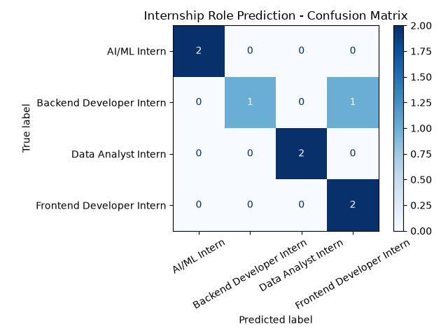
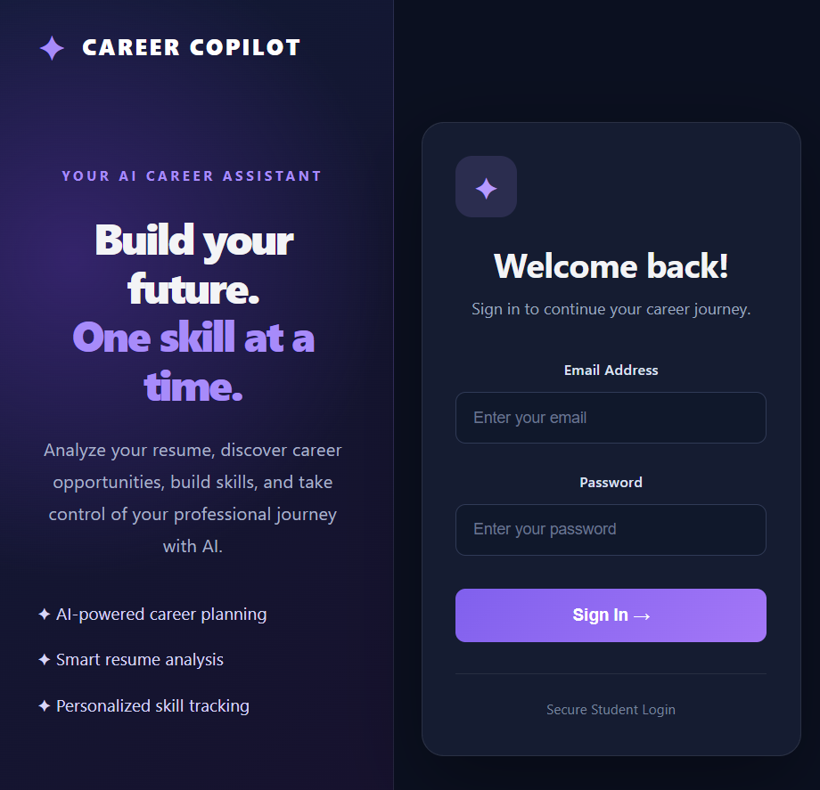
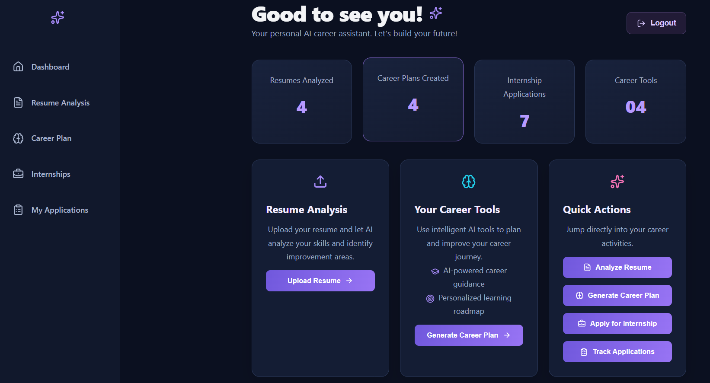
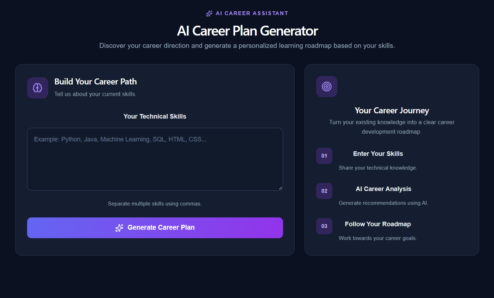
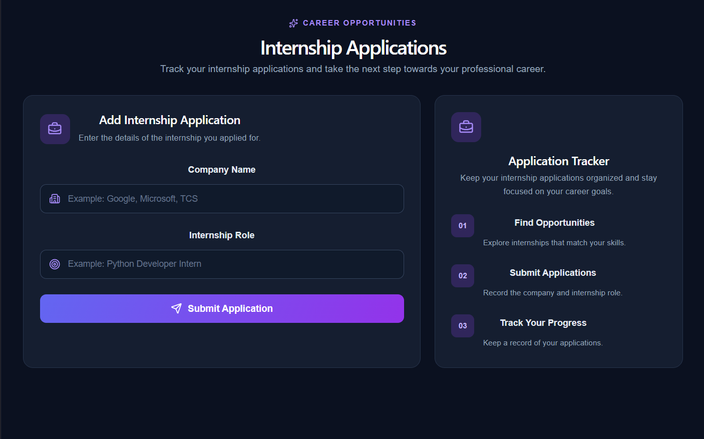
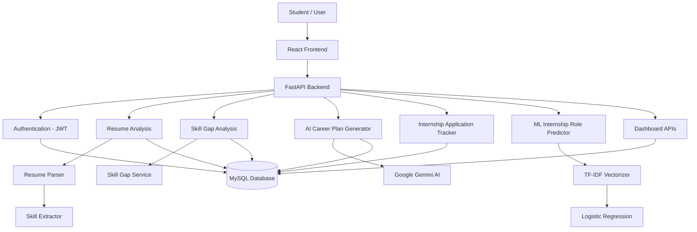

# AI Career & Internship Copilot 🚀

An AI-powered career assistant designed to help students analyze their resumes, identify skill gaps, explore career opportunities, and manage internship applications.

## 📌 About the Project

Students often struggle to identify suitable career paths, understand the skills required by companies, and find relevant internship opportunities.

**AI Career & Internship Copilot** addresses these challenges using Artificial Intelligence, Machine Learning, and a centralized career management platform.

It analyzes student resumes, recommends suitable career paths, generates personalized learning plans, predicts suitable internship roles using Machine Learning, and helps students track internship applications and skill development.

## ✨ Key Features

- **User Authentication:** Secure registration and login using JWT authentication.
- **Resume Analyzer:** Upload PDF resumes and extract relevant information and skills.
- **AI Career Planner:** Generate personalized career recommendations and learning roadmaps.
- **Skill Gap Analysis:** Identify skills that need improvement.
- **Project Recommendations:** Suggest projects based on career goals and skills.
- **ML Internship Role Predictor:** Predict suitable internship categories based on student skills using Logistic Regression.
- **Internship Tracker:** Add and manage internship applications.
- **Skill Tracker:** Add skills manually and monitor learning progress.
- **Dashboard:** View career plans, resumes, applications, and skill progress in one place.

## 🤖 Machine Learning Implementation

The project includes a supervised Machine Learning model that predicts suitable internship roles based on student skills.

**Machine Learning workflow:**

1. Collect student skills as text input.
2. Convert text into numerical features using TF-IDF Vectorization.
3. Train a Logistic Regression classification model.
4. Predict the most suitable internship category.
5. Display the predicted role in the React frontend.

**Algorithms and Libraries:**

- TF-IDF Vectorizer
- Logistic Regression
- Scikit-learn
- Matplotlib

**Supported internship categories:**

- AI/ML Intern
- Frontend Developer Intern
- Backend Developer Intern
- Data Analyst Intern

### Model Evaluation

The model was evaluated using an 80? No: 75% training and 25% testing split of the 32-example dataset.

| Evaluation Metric | Result |
|---|---:|
| Accuracy | 87.5% |
| Macro Precision | 92% |
| Macro Recall | 88% |
| Macro F1-score | 87% |

**Confusion Matrix**



**Note:** The current training dataset contains 32 synthetic examples, and the test set contains only 8 examples. These results are preliminary and should not be interpreted as real-world model performance.

## 📸 Application Screenshots

### 1. Login Page


### 2. Dashboard


### 3. Resume Analysis


### 4. AI Career Plan Generator


### 5. Internship Application Tracker


## 🏗️ System Architecture



## 🛠️ Technology Stack

| Category | Technologies |
|---|---|
| Frontend | React.js, JavaScript, HTML, CSS |
| Backend | Python, FastAPI, REST APIs |
| Database | MySQL |
| AI Integration | Google Gemini API |
| Machine Learning | Scikit-learn, TF-IDF, Logistic Regression |
| Data Visualization | Matplotlib |
| Authentication | JWT |
| Tools | VS Code, Git, GitHub, Vite |

## 📂 Project Structure

```text
AI-Career-Internship-Copilot/
│
├── backend/
│   ├── agents/
│   ├── database/
│   ├── services/
│   │   ├── internship_predictor.py
│   │   └── evaluate_internship_model.py
│   ├── main.py
│   └── requirements.txt
│
├── frontend/
│   ├── public/
│   ├── src/
│   │   ├── assets/
│   │   ├── pages/
│   │   ├── App.jsx
│   │   └── main.jsx
│   └── package.json
│
├── screenshots/
├── internship_confusion_matrix.png
├── .gitignore
└── README.md
```

## ⚙️ Installation and Setup

### 1. Clone the Repository

```bash
git clone https://github.com/Alex-1830/AI-Career-Internship-Copilot.git
```

```bash
cd AI-Career-Internship-Copilot
```

### 2. Backend Setup

Create a Python virtual environment:

```bash
python -m venv venv
```

Activate it on Windows:

```powershell
.\venv\Scripts\Activate.ps1
```

Install dependencies:

```bash
pip install -r backend/requirements.txt
```

Configure the required environment variables for MySQL, Gemini API, and JWT authentication in your backend `.env` file. Use the exact variable names expected by your application.

Create and configure the MySQL database before starting the backend.

Start the backend:

```bash
python -m uvicorn backend.main:app --reload
```

Backend API:

```text
http://127.0.0.1:8000
```

API documentation:

```text
http://127.0.0.1:8000/docs
```

### 3. Frontend Setup

Open another terminal:

```bash
cd frontend
```

Install dependencies:

```bash
npm install
```

Start the frontend:

```bash
npm run dev
```

Open the local URL displayed in your terminal, usually:

```text
http://localhost:5173
```

## 🔐 Security

- API keys and passwords must be stored in environment variables.
- The `.env` file must not be uploaded to GitHub.
- Authentication uses JWT tokens.
- Protected pages require authentication.

## 🎯 Project Objectives

- Simplify career planning for students.
- Improve resume quality and skill awareness.
- Recommend personalized learning paths.
- Predict suitable internship roles using Machine Learning.
- Help students organize internship applications.
- Encourage continuous skill development.

## 👨‍💻 Developer

**Alexander Paul K**

AI Career & Internship Copilot

GitHub: https://github.com/Alex-1830

## 🚀 Future Enhancements

- Real-time internship recommendations.
- Automated resume scoring and improvement suggestions.
- Job description and resume matching.
- Personalized AI career chatbot.
- Email notifications for internship opportunities.
- Advanced career analytics and progress tracking.
- Integration with LinkedIn for career opportunities.
- AI-powered interview preparation and practice.

---

⭐ If you find this project interesting, feel free to explore the repository!
